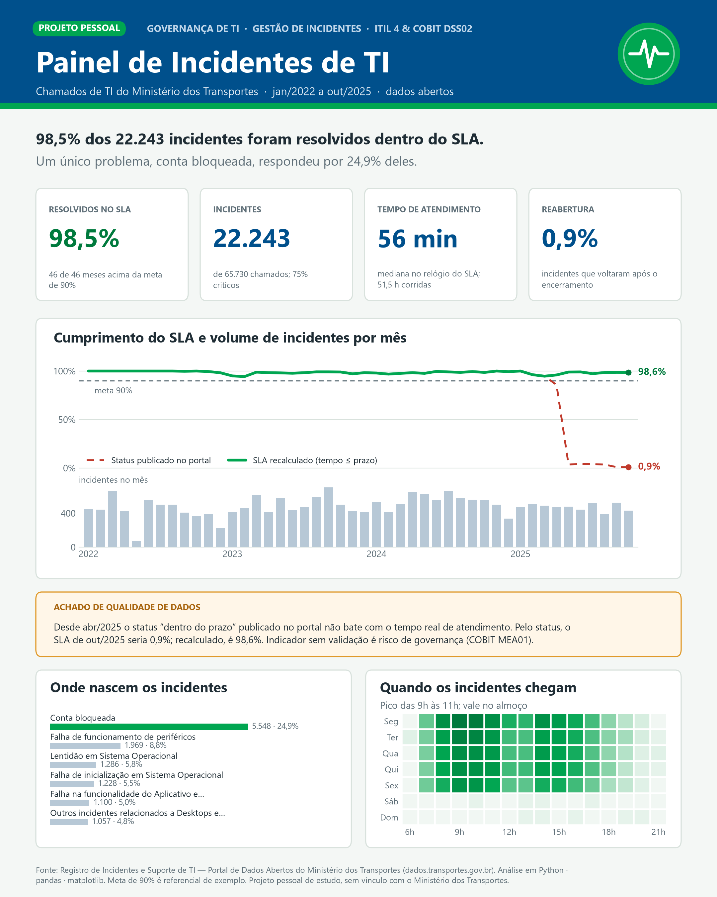

# Painel de Incidentes de TI: Governança e Gestão de Incidentes com Python


> **Projeto pessoal de estudo.** Análise de ~65 mil chamados de TI do **Ministério dos Transportes**
> (jan/2022 a out/2025) com foco em **Governança de TI** e na prática de **Gestão de Incidentes**
> (ITIL 4 e COBIT 2019, objetivo DSS02). Sem vínculo com o órgão.



**Versão interativa:** [`saida/painel_interativo.html`](saida/painel_interativo.html). Baixe e abra no navegador,
ou acesse pelo GitHub Pages (veja [Publicar o painel interativo](#publicar-o-painel-interativo)).

---

## Sumário
- [Objetivo](#objetivo)
- [Base de dados](#base-de-dados)
- [Principais resultados](#principais-resultados)
- [Achado de qualidade de dados](#achado-de-qualidade-de-dados)
- [Indicadores calculados](#indicadores-calculados)
- [Tecnologias](#tecnologias)
- [Estrutura do projeto](#estrutura-do-projeto)
- [Como executar](#como-executar)
- [Tratamento dos dados](#tratamento-dos-dados)
- [Limitações](#limitações)
- [Próximos passos](#próximos-passos)

## Objetivo
Responder, com dados públicos, a perguntas que uma área de governança de TI faria sobre o service desk:

1. Os incidentes estão sendo resolvidos dentro do SLA?
2. Quais serviços concentram os incidentes, e onde agir primeiro?
3. Em que dias e horários a demanda chega, para dimensionar a equipe?
4. Os indicadores publicados são confiáveis?

## Base de dados
**Registro de Incidentes e Suporte de TI**, do Portal de Dados Abertos do Ministério dos Transportes:
<https://dados.transportes.gov.br/dataset/registro-de-incidentes-e-suporte-de-ti>

| Item | Detalhe |
|---|---|
| Formato | ~45 arquivos CSV mensais |
| Período analisado | jan/2022 a out/2025 |
| Volume | 65.730 chamados, sendo 22.243 incidentes |
| Principais campos | tipo de chamado, serviço, grupo, criticidade, datas, tempo de atendimento, SLA, status de prazo, reabertura, canal de abertura |

Os arquivos são baixados automaticamente pela API CKAN do portal, sem download manual.

## Principais resultados

| Indicador | Resultado |
|---|---|
| Incidentes resolvidos dentro do SLA | **98,5%** (46 de 46 meses acima da meta de referência de 90%) |
| Tempo mediano de atendimento (relógio do SLA) | **56 min** |
| Tempo mediano de resolução (horas corridas) | **51,5 h** |
| Taxa de reabertura | **0,9%** |
| Incidentes classificados como críticos | **75%** |
| Maior causa isolada | **Conta bloqueada, com 24,9% dos incidentes** |

**Leituras para a gestão**
- **Pareto:** "conta bloqueada" sozinha gera 1 em cada 4 incidentes. Um portal de autoatendimento para desbloqueio e
  troca de senha teria o maior impacto na redução do volume.
- **Demanda:** o pico é das 9h às 11h em dias úteis, com uma queda clara no horário de almoço. Essa informação ajuda a montar a escala da equipe.
- **Qualidade da solução:** a reabertura abaixo de 1% indica que os incidentes são resolvidos de fato.
- **Prazo contratual x prazo percebido:** o SLA mede o tempo de atendimento descontando pausas (cerca de 1 h), enquanto o
  usuário espera cerca de 2 dias corridos. Vale discutir essa diferença com as áreas de negócio.

## Achado de qualidade de dados
A partir de **abr/2025**, quando muda o contrato e o layout dos arquivos, o status "Encerrado dentro/fora do prazo"
publicado no portal **deixa de corresponder** à regra *tempo de atendimento ≤ SLA*:

| Período | Concordância entre status publicado e regra | SLA pelo status publicado | SLA recalculado |
|---|---|---|---|
| jan/2022 a mar/2025 | 100% | ~98% | ~98% |
| mai/2025 a out/2025 | 2% a 7% | **1% a 4%** | **97% a 99%** |

Usando o status publicado sem validação, o SLA pareceria ter "despencado". O projeto recalcula o SLA pela regra em todo o período
e registra a divergência mês a mês na aba `qualidade_dados_sla` do relatório. Do ponto de vista de governança
(COBIT MEA01, monitoramento de desempenho), **um indicador publicado sem validação é um risco**.

## Indicadores calculados
- Volume de chamados por tipo: incidente, requisição, mudança e problema
- % de incidentes resolvidos dentro do SLA: geral, por mês e por criticidade
- Tempo de resolução: mediana e percentil 90
- Taxa de reabertura
- Pareto de serviços (regra 80/20)
- Distribuição por grupo de atendimento e canal de abertura
- Mapa de calor por dia da semana e hora
- Lista dos 50 piores casos fora do SLA, como insumo para a gestão de problemas

## Tecnologias
- **Python 3.12**
- **pandas:** coleta, limpeza e agregação
- **requests:** acesso à API CKAN do portal
- **matplotlib:** gráficos e painel estático em PNG
- **Plotly:** painel interativo em HTML
- **openpyxl:** relatório em Excel

## Estrutura do projeto
```
gestao_incidentes_ti/
├── coleta.py               # lista e baixa os CSVs mensais pela API do portal (com cache em dados/)
├── analise_incidentes.py   # limpeza, KPIs, relatório Excel e gráficos
├── exportar_painel.py      # gera os CSVs agregados usados pelos painéis
├── painel_png.py           # painel estático (PNG 4:5) com matplotlib
├── painel_interativo.py    # painel interativo (HTML) com Plotly
├── requirements.txt
├── docs/
│   └── index.html          # cópia do painel interativo para o GitHub Pages
└── saida/
    ├── painel_incidentes_ti.png
    ├── painel_interativo.html
    ├── relatorio_gestao_incidentes.xlsx
    ├── 1_evolucao_sla.png … 4_mapa_calor.png
    └── painel/             # dados agregados (CSV)
```

## Como executar
```bash
# 1. Clonar o repositório
git clone https://github.com/igortoleto/Incidentes---Minist-rio-do-transporte.git
cd Incidentes---Minist-rio-do-transporte

# 2. (Opcional) criar um ambiente virtual
python -m venv .venv
.venv\Scripts\activate          # Windows
# source .venv/bin/activate     # Linux/macOS

# 3. Instalar as dependências
pip install -r requirements.txt

# 4. Rodar a análise completa (a 1ª execução baixa ~25 MB do portal)
python analise_incidentes.py

# 5. Gerar os painéis
python exportar_painel.py
python painel_png.py
python painel_interativo.py
```

### Publicar o painel interativo
1. No GitHub, abra **Settings → Pages**.
2. Em *Source*, escolha **Deploy from a branch**, branch `main` e pasta `/docs`.
3. O painel fica disponível em <https://igortoleto.github.io/Incidentes---Minist-rio-do-transporte/>.

## Tratamento dos dados
- Os arquivos alternam entre as codificações UTF-8 e Latin-1, então a leitura tenta as duas.
- Categorias com e sem acento ("Requisição" e "Requisicao") foram padronizadas.
- As colunas "Severidade" (2022) e "Criticidade" (2023 em diante) foram unificadas.
- As duas grafias da coluna de reabertura foram unificadas.
- Datas com e sem segundos foram convertidas com `format="mixed"`.
- Os arquivos de 2020, que têm outro layout, e um link quebrado (05/2022) foram descartados.
- O SLA foi recalculado pela regra *tempo de atendimento ≤ SLA* (veja o achado acima).

## Limitações
- A meta de 90% é um **referencial de exemplo**. A meta real está no contrato do órgão, que não faz parte da base.
- O tempo de resolução em horas é **corrido**: inclui noites, fins de semana e pausas.
- O tempo de atendimento é o **relógio do SLA** informado pelo órgão. Não é possível auditar as pausas.
- Os dados refletem o que o órgão publica. Campos de texto livre, como título e descrição, não foram usados.

## Próximos passos
- Classificar os títulos dos chamados com técnicas de NLP para encontrar causas raiz
- Prever o volume de incidentes por semana com modelos de séries temporais
- Montar um app com filtros (Streamlit) para análise exploratória

---

**Aviso:** projeto pessoal de estudo, feito com dados abertos e sem vínculo com o Ministério dos Transportes.
As conclusões são do autor e não representam posição oficial do órgão.
